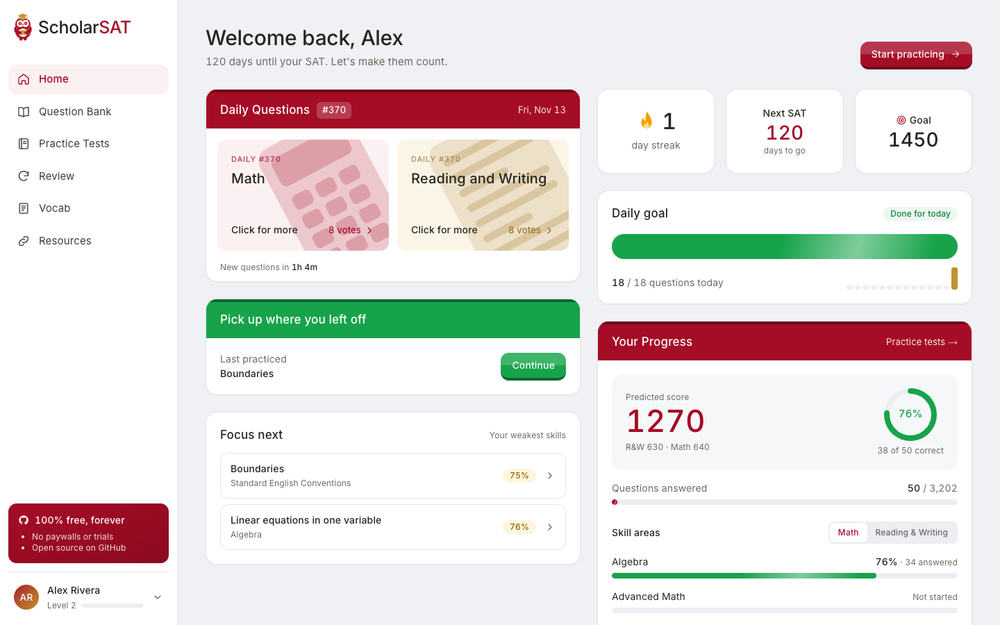
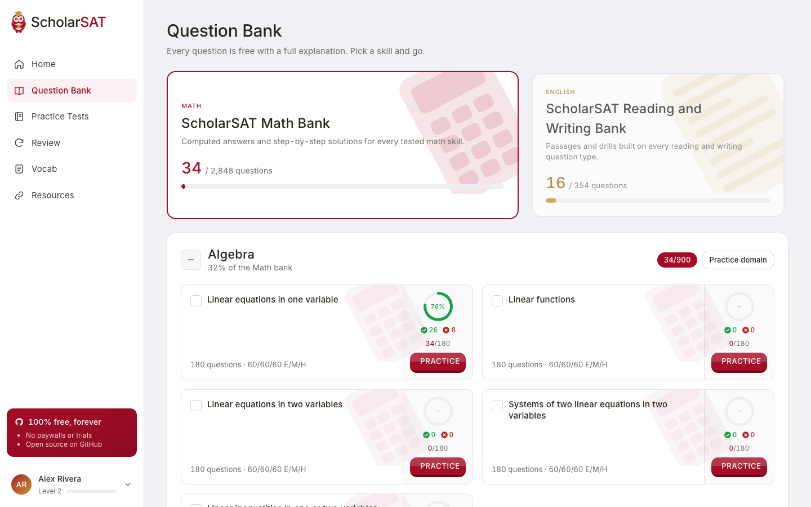
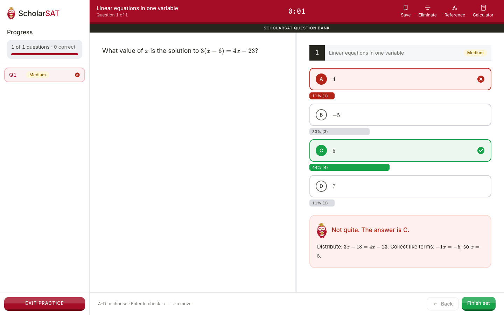
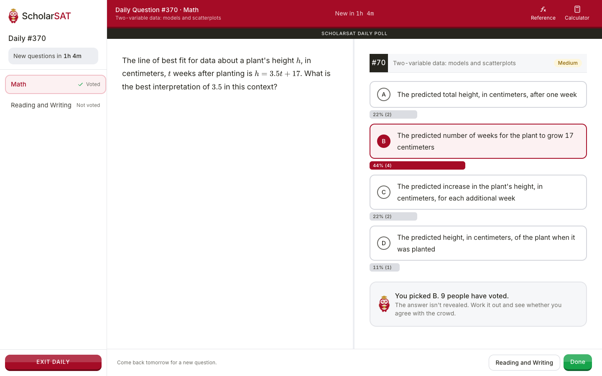
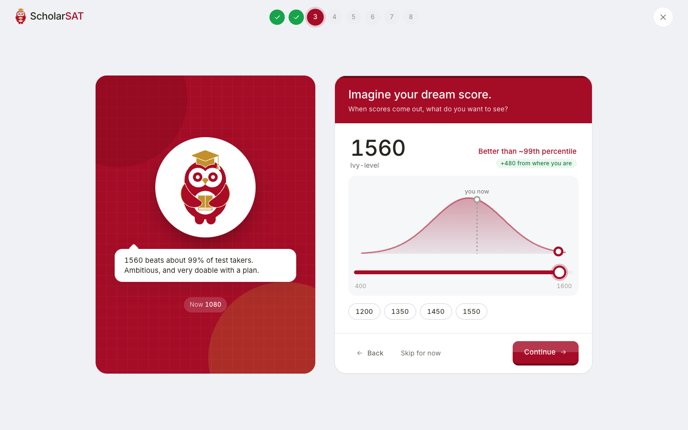
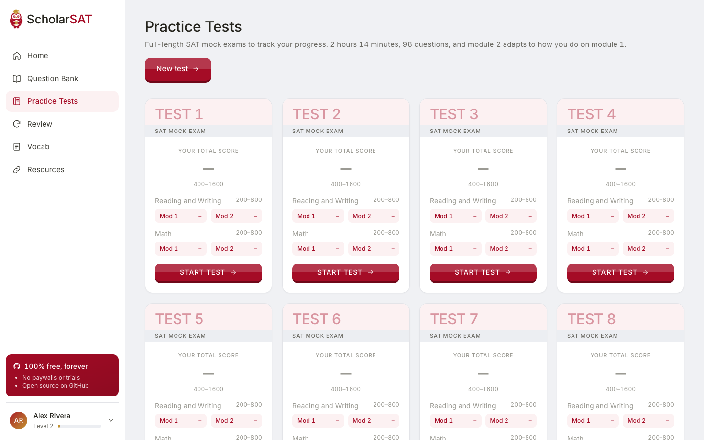
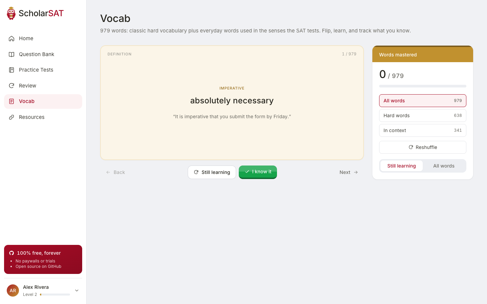
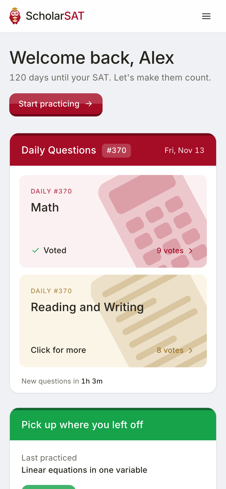
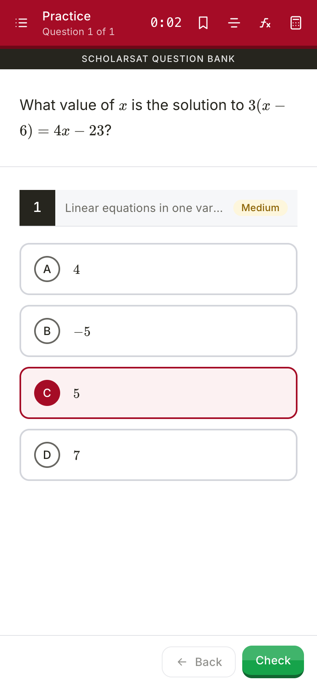
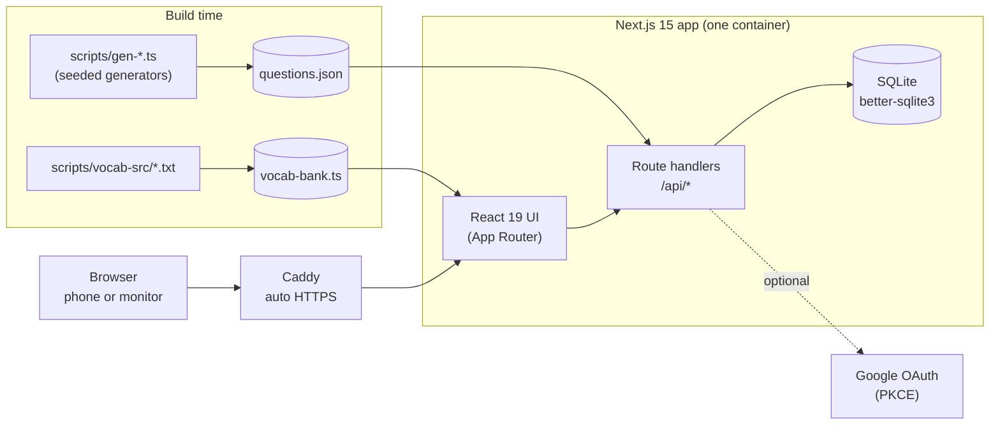

<div align="center">


# ScholarSAT

### Free SAT prep. No paywalls. No trials. No catch.

Thousands of original practice questions, adaptive full-length mock tests, a study plan built around your goal,<br />
and a mascot who judges your wrong answers. Open source, MIT licensed, and free forever.

<br />

[](https://scholarsat.com)
[](LICENSE)


**[Try it](https://scholarsat.com)** · **[Features](#-features)** · **[How it works](#-how-it-works)** · **[Run it locally](#-run-it-locally)** · **[Contribute](#-contributing)**

<br />



</div>

<br />

## Why this exists

SAT prep shouldn't depend on what your family can afford. The good platforms charge hundreds of dollars, and the free ones are usually a PDF and good luck.

ScholarSAT is a full prep platform, not a teaser for a paid one. Every question, every mock test, every feature is unlocked for everyone, and the whole thing is open source so anyone can read it, improve it, or run their own copy for a school or club.

It is built by [**CodeStarters**](https://codestarters.org), a student-led nonprofit that makes computer science and AI accessible to every young student.

## At a glance

| | |
|---|---|
| **3,202** | original practice questions: **2,848** Math and **354** Reading & Writing |
| **29** | skills across **8** domains, covering the digital SAT's published structure |
| **1,705 / 1,497** | multiple-choice and student-produced-response (type-in) questions |
| **1,079 / 1,159 / 964** | easy, medium, and hard questions |
| **98** | questions in a full mock test: 4 timed modules, **2h 14m**, module 2 adapts to module 1 |
| **979** | vocabulary words: 638 classic hard words plus 341 everyday words used in the senses the SAT tests |
| **$0** | what any of it costs, forever |

## A quick tour

<table>
  <tr>
    <td width="50%"><br /><sub><b>Question bank.</b> Pick a skill, see your accuracy ring, practice a skill, a whole domain, or any mix you tick.</sub></td>
    <td width="50%"><br /><sub><b>Answer feedback.</b> Right and wrong are obvious, plus what share of other students picked each choice, and a worked explanation.</sub></td>
  </tr>
  <tr>
    <td width="50%"><br /><sub><b>Daily question poll.</b> One Math and one Reading & Writing question a day. Vote, see what the crowd picked, never see the answer. Resets every 24 hours.</sub></td>
    <td width="50%"><br /><sub><b>Onboarding.</b> Drag along the national score curve to set your dream score, then get a plan built backwards from your test date.</sub></td>
  </tr>
  <tr>
    <td width="50%"><br /><sub><b>Mock tests.</b> Full-length, timed, and adaptive. Scores and per-module results fill in as you finish each one.</sub></td>
    <td width="50%"><br /><sub><b>Vocabulary.</b> 979 words with flashcards, shuffle, and a filter for hard words versus everyday words with SAT meanings.</sub></td>
  </tr>
</table>

<div align="center">

&nbsp;&nbsp;&nbsp;

<br /><sub><b>Built for phones too.</b> The same app, reflowed: icon-only tool bars, thumb-sized answers, safe-area padding for the home indicator. It also scales up cleanly for 1440p and ultrawide monitors.</sub>
</div>

## ✨ Features

**Practice**
- **Question bank** with every domain and skill on the digital SAT. Filter by skill, difficulty, and your own history (unanswered, missed, saved). Practice one skill, a whole domain, or a custom mix.
- **Full-screen practice player** with a question list, per-question timer, answer elimination, a math reference sheet, an optional embedded Desmos calculator, and keyboard shortcuts (`A`–`D`, `Enter`, arrows).
- **Crowd stats after every answer.** See what percentage of students chose each option, so you can tell a trap answer from a common mistake.
- **Type-in answers that accept any equivalent form.** `1/2`, `.5`, and `0.5` are all correct.
- **Math rendered with KaTeX.**

**Test day**
- **Adaptive full-length mock tests** structured like the real digital SAT: Reading & Writing (2 × 27 questions, 32 min each) and Math (2 × 22 questions, 35 min each). Module 2 gets harder or easier based on how you did on module 1.
- **Score report** with an estimated 400–1600 score, section scores, a by-domain breakdown, and a clickable answer review.
- **Saves automatically.** The timer keeps running if you close the tab, and you can resume where you left off.

**Stay on track**
- **Onboarding that builds a plan.** Current score, dream score, graduating class, test date, daily time, and the areas that feel shaky turn into a daily question target and a typical week.
- **Dashboard** with predicted score, accuracy by domain, streak, daily goal, and your weakest skills to focus on next.
- **Mistake review.** Every question you miss is saved until you get it right, and you can bookmark anything.
- **Daily question poll** with a 24-hour reset and a countdown to the next one.
- **Vocabulary bank** with 979 words, flashcards, shuffle, and per-word progress.

**The app itself**
- Email signup **or Google sign-in**, with account linking and a way to disconnect.
- **Animated owl mascot** (a hand-split SVG) that blinks, flaps, hops on correct answers, droops on wrong ones, and covers its eyes when you type a password.
- **Responsive on purpose:** audited from 320px phones to 3440px ultrawides.
- **No analytics, no trackers, no ads.** The only third parties are Google (if you choose Google sign-in) and Desmos (if you set an API key).

## 🧠 How it works

### Every question is original, and every answer is computed

None of the questions are copied from the College Board or any prep company. They're generated by this repo:

- **Math** comes from parameterized templates in [`scripts/gen-math.ts`](scripts/gen-math.ts). Each template picks random numbers, builds the question, and **calculates the answer in code**. Nobody types an answer, so there's no typo to get wrong. The wrong choices are computed too (sign flips, off-by-one values, and other plausible near-misses).
- **Reading & Writing** uses frames and passages written for this project in [`scripts/rw-conventions.ts`](scripts/rw-conventions.ts) and [`scripts/rw-reading.ts`](scripts/rw-reading.ts), turned into questions by [`scripts/gen-rw.ts`](scripts/gen-rw.ts).
- The generator is **seeded**, so the bank is reproducible. `npm run bank` rebuilds `src/data/questions.json`, and it runs automatically before every build.

A real template, trimmed:

```ts
(r) => {
  const x = r.int(-9, 12), a = r.int(2, 9), b = r.nz(-20, 20), c = a * x + b;
  return mcq(r, B(
    `If ${m(`${expr([[a, "x"], [b, ""]])} = ${c}`)}, what is the value of ${m("x")}?`,
    `Subtract ${m(String(b))} from both sides: ${m(`${a}x = ${c - b}`)}. Divide by ${m(String(a))}: ${m(`x = ${x}`)}.`),
    m(String(x)), nums([x + 1, /* ...computed distractors... */ x - 2]));
}
```

### Adaptive mock tests

A test is four timed modules, like the real thing. After module 1 of each section, the app scores your performance weighted by difficulty (easy 1, medium 1.4, hard 1.8). At 60% or better, module 2 is **harder** (45% hard questions); otherwise it's **easier** (50% easy). Section scores combine both modules (45% / 55%) and cap at 800 on the harder path and 620 on the easier one, which mirrors how the real test rewards the harder route. The total is an *estimate* meant for tracking progress, not an official score.

### Predicted score

Once you've answered at least 10 questions in each section, your dashboard predicts a score from your accuracy, using the latest answer to each question so old mistakes don't haunt you forever. It updates as you practice.

### Daily poll

Each day at 00:00 UTC everyone gets the same two multiple-choice questions. You pick, you vote, and you see how everyone else voted. Votes are one per person per day. The answer is never sent to the browser, so there's nothing to peek at.

### Onboarding, simulated for real

The onboarding at [`/onboarding`](src/components/onboarding/Onboarding.tsx) works signed out as a full demo. If you sign up afterward, your answers carry over to your new account. Percentile figures come from a simple normal model of national scores. They're for motivation and planning, not official data.

### The vocabulary bank

Words live as plain text lines in [`scripts/vocab-src/`](scripts/vocab-src), and [`scripts/build-vocab.ts`](scripts/build-vocab.ts) validates them (duplicates, part of speech, example sentence actually uses the word) and generates the data file. There are two kinds: **classic** hard words, and **context** words, which are everyday words whose definition gives the less obvious sense the SAT tests.

## 🏗 Architecture



One Node process, one SQLite file, no external services required. That's deliberate: a school or club can run the whole thing on a small VPS.

<details>
<summary><b>Project structure</b></summary>

```
.
├── scripts/
│   ├── gen-math.ts          # parameterized Math templates (answers computed)
│   ├── gen-rw.ts            # Reading & Writing question builder
│   ├── rw-conventions.ts    # Standard English frames
│   ├── rw-reading.ts        # passages for Reading questions
│   ├── build-bank.ts        # writes src/data/questions.json
│   ├── build-vocab.ts       # validates and builds the vocab bank
│   └── vocab-src/*.txt      # vocabulary, one word per line
├── src/
│   ├── app/
│   │   ├── (app)/           # signed-in shell: dashboard, practice, tests, review, vocab, settings
│   │   ├── (auth)/          # login and signup
│   │   ├── daily/[section]/ # full-screen daily poll
│   │   ├── onboarding/      # the plan builder
│   │   └── api/             # attempt, tests, daily, vocab, onboarding, settings, auth/*
│   ├── components/          # UI kit, practice player, test runner, owl, onboarding
│   ├── lib/                 # db, auth, google oauth, stats, tests engine, onboarding math
│   └── data/                # generated question bank + vocabulary
├── deploy/                  # server setup, Caddyfile, deploy and SSH hardening scripts
├── Dockerfile               # multi-stage build, non-root user, healthcheck
├── docker-compose.yml       # app + Caddy
└── .github/workflows/       # CI, and deploy on push to main
```

</details>

## 🚀 Run it locally

You need **Node.js 22** (what CI and the Docker image use).

```bash
git clone https://github.com/Codestarters-Foundation/scholarsat.git
cd scholarsat
npm install
npm run dev
```

Open <http://localhost:3000>. That's the whole setup. `npm run dev` builds the question bank first (a couple of seconds), and the SQLite database is created on first use in `./data/` (override with `DATA_DIR`).

### Scripts

| Command | What it does |
|---|---|
| `npm run dev` | Builds the question bank, then starts the dev server on port 3000 |
| `npm run build` | Production build (rebuilds the bank first) |
| `npm run start` | Serves the production build |
| `npm run bank` | Regenerates `src/data/questions.json` from the generators |
| `npx tsx scripts/build-vocab.ts` | Validates and rebuilds the vocabulary bank |
| `npm run typecheck` | Rebuilds the bank, then runs `tsc --noEmit` |
| `npm run lint` | ESLint |

### Configuration

Everything is optional for local development.

| Variable | Purpose |
|---|---|
| `GOOGLE_CLIENT_ID` / `GOOGLE_CLIENT_SECRET` | Turns on "Continue with Google". Create a *Web application* OAuth client and add `http://localhost:3000/api/auth/google/callback` (and your production URL) as authorized redirect URIs. The button only appears when both are set. |
| `NEXT_PUBLIC_DESMOS_API_KEY` | Embeds the Desmos graphing calculator in the player and tests. Without it, the Calculator button opens desmos.com in a new tab. Inlined at build time. |
| `DATA_DIR` | Where the SQLite database lives (default `./data`). |
| `SITE_URL` | Public URL, used for metadata and OAuth redirects in production. |
| `NEXT_PUBLIC_REPO_URL` | Where the GitHub links point. |
| `INSECURE_COOKIES=1` | Allows session cookies over plain HTTP. Only for testing on a bare IP, never once you have HTTPS. |

**Fonts:** the UI is set in the CursorGothic + Berkeley Mono pairing and falls back to Inter and the system monospace. Drop `CursorGothic-Regular.woff2`, `CursorGothic-Medium.woff2`, and `BerkeleyMono-Regular.woff2` into `public/fonts/` and they load automatically at the next build. They're licensed, so they aren't in the repo.

## 🌍 Deploy it

ScholarSAT runs happily on a single small VPS with Docker and [Caddy](https://caddyserver.com), which fetches and renews HTTPS certificates on its own.

1. Point an A record for your domain at the server.
2. One-time server setup (as root, after adding your SSH key):
   ```bash
   ssh root@HOST 'bash -s' < deploy/setup-server.sh
   ```
   This creates a `deploy` user, enables the UFW firewall (22/80/443) and fail2ban, installs Docker, and clones the repo to `/opt/scholarsat`.
3. On the server: `cp .env.example .env` and fill it in.
4. Run `./deploy/deploy.sh`. It pulls, builds, restarts, and waits for the health check.
5. After confirming key-based login works, `ssh root@HOST 'bash -s' < deploy/harden-ssh.sh` turns off password SSH.

**Continuous deployment:** the included GitHub Actions workflow typechecks and builds on every push and pull request, and deploys `main` over SSH when the `DEPLOY_ENABLED` variable and the `DEPLOY_SSH_KEY`, `DEPLOY_HOST`, and `DEPLOY_KNOWN_HOSTS` secrets are set. It can also sync Google and Desmos keys into the server's `.env`.

**Operating it:** logs are `docker compose logs -f app` (or `caddy`) in `/opt/scholarsat`, and the database lives in the `scholarsat_appdata` Docker volume, so that's what to back up. A health endpoint is available at `/api/health`.

## 🔐 Security and privacy

- Passwords are hashed with **bcrypt** (cost 11). Sessions are random 256-bit tokens in `httpOnly`, `SameSite=Lax` cookies (`Secure` in production) that expire after 30 days.
- **Google sign-in** uses the authorization-code flow with **PKCE** and a `state` check, validates the ID token's issuer, audience, expiry, and verified email, and only follows same-site redirects. Because email signups aren't verified, signing in with Google using an email that already has a password account clears that password and its sessions. The real owner proved control of the address.
- Login, signup, and Google endpoints are **rate limited**.
- The daily poll never sends the correct answer to the client.
- Security headers are set for all routes (`X-Frame-Options: DENY`, `nosniff`, a strict `Referrer-Policy`, and a locked-down `Permissions-Policy`).
- There is **no analytics, tracking, or advertising** in the code.

Found a vulnerability? Please don't open a public issue. Contact the maintainers privately through GitHub instead.

## 🤝 Contributing

This project gets better one question at a time, and you don't need to be a developer to help.

**Add questions.**
- *Reading & Writing:* add frames or passages to [`scripts/rw-conventions.ts`](scripts/rw-conventions.ts) or [`scripts/rw-reading.ts`](scripts/rw-reading.ts). The R&W bank (354 questions) is the smaller side and the best place to make a big difference.
- *Math:* add a template to [`scripts/gen-math.ts`](scripts/gen-math.ts). Compute the answer in code, and compute the wrong choices from realistic mistakes.
- Run `npm run bank`, look at the new questions in the app, and open a PR.

**Add vocabulary.** Append lines to a file in [`scripts/vocab-src/`](scripts/vocab-src):

```
word|part of speech|definition|example sentence|kind
```

Use `c` for a classic hard word and `x` for an everyday word used in an SAT-tested sense. Write the definition and the example yourself. Don't copy them from a dictionary, Quizlet, or another prep site. Then run `npx tsx scripts/build-vocab.ts`, which will tell you about any problems.

**Fix bugs and polish the UI.** Fork, branch, and before opening a PR make sure these pass:

```bash
npm run typecheck && npm run lint && npm run build
```

**Ground rules**
- Everything must be **original**. No copied College Board questions, no pasted competitor content.
- Keep it free. No paywalls, upsells, or gating features behind accounts.
- Keep it light. Prefer a small, readable change over a new dependency.

## 🗺 Ideas up for grabs

Not promises, just good places to start if you want to build something:

- More Reading & Writing questions, especially Craft and Structure, which is the thinnest domain
- Dark mode (the design uses CSS variables throughout, so it's mostly a palette)
- Bundle the UI font locally so builds never depend on a font download
- Tests for the question generators (the seeded RNG makes them easy to snapshot)
- An accessibility audit with a screen reader pass
- Spaced repetition for the vocabulary flashcards
- Question reports ("this answer looks wrong") that land in an issue tracker

## ❓ FAQ

**Is it really free?** Yes. No trial, no premium tier, no credit card. The code is public so you can check.

**Are these official College Board questions?** No. They're original and follow the published structure of the digital SAT (same domains, skills, and formats). For official material, the app links straight to College Board's free Bluebook tests and Question Bank, and you should use them. They're the best benchmark.

**How accurate is the predicted score?** It's an estimate from your accuracy on ScholarSAT questions. Use it to track direction, not to predict test day to the point.

**Do I need an account?** No. You can practice from the question bank right away. An account adds progress tracking, saved questions, mistake review, mock tests, and your study plan.

**Can I run it for my school?** Please do. It's MIT licensed, runs on a small server, and has no external dependencies.

## Disclaimer

SAT® is a trademark registered by the College Board, which is not affiliated with, and does not endorse, this project. Percentiles and score estimates are for planning only and are not official College Board data.

## License

[MIT](LICENSE). Use it, fork it, teach with it.

<div align="center">
<br />

**Built with 🦉 by [CodeStarters](https://codestarters.org)** · Contributions welcome · [scholarsat.com](https://scholarsat.com)

</div>
